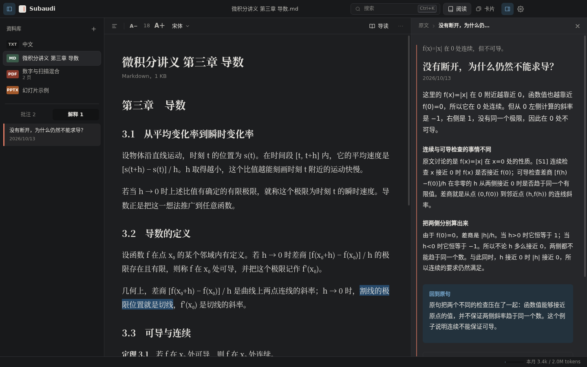

<h1 align="center">Subaudi</h1>

<p align="center"><b>读原著，不再卡在省略处。</b></p>

<p align="center">一个本地优先的教材阅读器：选中读不懂的句子，在页边补上作者没写出的前提、步骤和条件，再带你回到原句。</p>

<p align="center">
  <a href="docs/USER-GUIDE.md">使用手册</a> ·
  <a href="#下载与安装">下载</a> ·
  <a href="#从源码构建">从源码构建</a> ·
  <a href="docs/ARCHITECTURE.md">架构</a> ·
  <a href="docs/CHANGELOG-0.2.0.md">更新说明</a>
</p>


> **English summary.** Subaudi is a local-first desktop reader for textbooks and papers (PDF, DOCX, PPTX, PPT, Markdown, TXT). Select a passage you don't understand and it writes a margin note that restores what the author left implicit — prerequisites, skipped steps, conditions — labels every claim by its basis (source, derivation, or background knowledge), and leads you back to the original sentence. Highlights, notes, search, on-device OCR and an embedded Anki spaced-repetition library run entirely offline; only explanation, overview and card generation send the relevant text to the AI provider you configure (DeepSeek, OpenAI, Anthropic, or any OpenAI-compatible endpoint). The interface is currently Chinese-only and Windows-only.

---

## 为什么做 Subaudi

专家读教材时，会不自觉地补上书里没写的东西：这个记号是什么意思，这一步用了哪条定理，这个条件为什么不能去掉。初学者缺的正是这些，于是卡在一句话上，或者跳过去、似懂非懂地往下读。

通用的 AI 聊天能回答问题，但它不知道你正在读哪本书的哪一句，回答也常常脱离原文的语境和记号。Subaudi 把解释锚定在原文上：

- **以原句为中心**：解释说明这句话在**这里**是什么意思，最后总要回到原句；
- **补缺口，不写摘要**：重点是作者省略的前提、推导步骤、适用条件和边界；
- **依据可核对**：每个论断标明来自原文、推导还是一般背景知识，原文出处可以一键跳回；
- **按读者起点讲**：你在设置里写下学过什么，解释据此决定补讲多少；
- **能层层追问**：在解释里继续划选，直到读通为止。

## 功能

**阅读**

- PDF 原版式阅读：目录、书签、跳转返回、连续 / 单页、缩放、旋转、文内链接
- Word、PowerPoint、Markdown、TXT 重排为一栏正文，字号、字体、行宽可调，目录随滚动高亮
- 扫描版 PDF 本地文字识别（RapidOCR），可一键识别全部扫描页，识别结果可人工修正
- 明亮、护眼、夜间三套主题

**理解**

- 选中文字即弹出工具条：解释、提问、高亮、批注、复制
- “提问”：写下具体疑惑再解释；“深入分析”：先诊断缺口，生成后自审修订
- 导读：概括当前部分的核心问题、论述路线、前置概念和可能卡住的地方
- 解释可以继续追问，面包屑记录路径；可标记有误，相关缓存同时失效
- 参考资料：解释时自动从你加入的其他教材、讲义中检索相关段落作为依据
- 可选联网检索（自建 SearXNG）

**记忆**

- 内置官方 Anki 内核与 FSRS 调度：复习、浏览、编辑、导入导出 `.apkg` / `.colpkg` / `.anki2`
- 从资料制卡：逐段列出知识点，每个知识点至少一张卡，附原文出处；中断后可续做

**其他**

- `Ctrl+K` 命令面板与全文搜索
- 四色高亮与批注，可导出为带标准注释的 PDF
- 拖拽、多选导入；自动记住每份资料的阅读位置
- 月度 token 用量与上限、逐次请求账本

## 截图

| 选中文字后的工具条 | 带具体问题提问 |
| --- | --- |
|  |  |
| **导读** | **依据与关键论断** |
|  |  |
| **搜索与命令面板** | **夜间主题** |
|  |  |

## 下载与安装

在本仓库的 Releases 页面下载最新的 `Subaudi-版本号.exe`，双击运行，无需安装，也不需要 Python 或 Office。

- 系统要求：Windows 10 / 11，64 位
- 发布包暂未签名，Windows 可能提示“已保护你的电脑”，点 **更多信息 → 仍要运行**

## 快速开始

1. **打开资料**：把 PDF、Word、PowerPoint、Markdown 或 TXT 文件拖进窗口，或按 `Ctrl+O`。
2. **配置 AI 服务**：按 `Ctrl+,`，选择服务商，粘贴 API Key，点 **测试连接**，再 **保存**。顺便在“关于我”写一两句你的背景。
3. **解释**：选中一句读不懂的话，点 **解释**（`Ctrl+E`），或点 **提问** 写下你的具体疑惑。

完整说明见 **[使用手册](docs/USER-GUIDE.md)**。

## 隐私

阅读、高亮、批注、书签、搜索、文字识别和卡片复习都只在本机进行。API Key 由 Windows 系统加密保存在本机。

只有在你使用以下功能时，相关文字才会发送给**你自己配置**的 AI 服务：

| 功能 | 发送的内容 |
| --- | --- |
| 解释 / 提问 | 选区、所在段落及前后各一段、最多 4 段检索到的相关段落、上层解释（追问时）、你的问题、“关于我” |
| 导读 | 从当前位置起最多 6 段原文 |
| 从资料制卡 | 资料的全部正文 |

任何一份资料都可以设为“仅本地”，完全不参与 AI 处理；也可以在设置中整体关闭 AI。详见使用手册的[隐私一章](docs/USER-GUIDE.md#12-隐私哪些内容会离开你的电脑)。

---

## 从源码构建

### 环境要求

| 工具 | 版本 | 用途 |
| --- | --- | --- |
| Node.js | 22.13 或更高 | 构建、测试（主进程使用内置的 `node:sqlite`） |
| Python | 3.13 | 开发时直接运行 Office 解析、OCR 与卡片库内核；打包 sidecar |
| Windows 10 / 11 x64 | — | 打包发布版（sidecar 由 PyInstaller 构建 Windows 可执行文件） |

日常开发（界面、主进程、提示词）在 macOS 和 Linux 上也可以进行；打包发布需要 Windows。

### 开发

```bash
git clone <仓库地址> subaudi
cd subaudi
npm ci

# Python 依赖（开发时 sidecar 以脚本方式运行）
python -m pip install -r services/parser/requirements.txt
npm run setup:parser        # 安装 olefile 到 .tools/parser-runtime（.ppt 解析，打包时据此收入）
npm run setup:anki          # 安装固定版本的 Anki 内核到 .tools/anki-runtime

npm start                   # 开发构建（带 sourcemap）并启动 Electron
```

### 检查与测试

```bash
npm run check               # TypeScript 类型检查
npm test                    # 单元测试
npm run test:anki           # Anki 适配层与 PPT/PPTX 解析器测试（Python）
npm run ui                  # 构建并在真实 Electron 窗口中跑界面冒烟测试
```

`npm run ui` 依次走完导入五种格式、选区、提问、设置与测试连接、解释、依据、高亮、导读、搜索、PDF、幻灯片、三套主题和卡片库，逐步截图到 `test-results/ui/`，出现任何页面错误即失败。测试在主进程中替换了模型接口，不需要 API Key，也不产生费用。在无显示器的 Linux 上可用 `xvfb-run -a npm run ui`。

真实模型评测会产生费用：`npm run probe -- K01`（需在环境变量中设置 `DEEPSEEK_API_KEY`），或 `npx tsx scripts/live-check.ts K11`（从终端隐藏输入 Key）。评测用例在 `evals/cases.json`。

### 打包

在 Windows 上双击根目录的 `build-release.bat`，或在终端运行：

```powershell
build-release.bat           # 完整流程（等同于 npm run release）
build-release.bat --fast    # 跳过类型检查与测试
build-release.bat --smoke-only   # 只重新检查 release\win-unpacked 中已打包的 sidecar
```

完整流程依次：检查 Node.js / Python 3.13 / PyInstaller（缺少 `node_modules` 或 Anki 运行时会自动安装）→ 类型检查与全部测试 → 构建三个 sidecar → 构建便携版 EXE → 以与应用相同的协议调用发布包中的卡片库内核、文档解析和文字识别各一次。任何一步失败即停止，不会留下“打包成功但不能用”的 EXE。

也可以分步执行：

```powershell
npm run build:sidecars      # Office 解析 + OCR → services/parser/dist、ocr-dist
npm run build:anki          # 卡片库内核     → services/anki/dist
npm run dist                # 便携版 EXE     → release/
```

分步执行不包含冒烟测试，发布前请再运行一次 `build-release.bat --smoke-only`。sidecar 构建脚本会排除各组件从不导入的大型模块，并在结束后清理 PyInstaller 中间目录。

## 架构

```
┌──────────────────────────── 渲染进程（React，沙箱） ───────────────────────────┐
│  app.tsx 外壳 · TextDoc / Pdf 阅读器 · Margin 页边解释 · Palette 搜索与命令      │
│  Settings · AnkiPanel 卡片库 · kit（菜单 / 对话框 / Toast） · style.css 设计令牌  │
└───────────────────────────────┬──────────────────────────────────────────────┘
                                │ contextBridge（preload.ts），zod 校验每个 IPC 参数
┌───────────────────────────────▼────────────────── 主进程（main.ts） ────────────┐
│  导入与去重 · 解释流水线（检索依据 → 诊断 → 生成 → 审查 → 修订 → 契约校验）        │
│  精确缓存与 single-flight · 月度用量账本 · 导出 / 恢复 · 带批注 PDF               │
├──────────────┬──────────────────┬──────────────────┬──────────────────────────┤
│ SQLite       │ 常驻 sidecar     │ 模型 API          │ SearXNG（可选）           │
│ 记录 + FTS5  │ （worker.ts）     │ OpenAI 兼容 /     │ 只读取公开 HTTPS 网页，    │
│ 中文单字索引  │ 解析 · OCR · Anki │ Anthropic Messages│ 拒绝本机与私网地址         │
└──────────────┴──────────────────┴──────────────────┴──────────────────────────┘
```

- **锚点不可变**：每个选区以“块 ID + 码点偏移 + 原文引文”保存，主进程在调用模型前逐段校验，保证解释、批注始终指向确切的原文。
- **结构化输出**：模型必须返回符合 `prompts/explanation.schema.json` 的 JSON；程序检查小节与引用编号一致、推导型论断指向存在的小节、原文型论断附有来源，不合格时最多修复一次。
- **缓存**：解释签名包含请求、读者背景、模型配置、全部依据、提示词版本和适配器版本，任一变化都会生成新解释；签名相同则不调用 API。
- **sidecar**：Office 解析、OCR、Anki 内核都是独立的 Python 进程，经 JSON lines 通信。进程常驻复用，超时或取消时终止并在下次调用时自动重启。

更详细的设计见 [docs/ARCHITECTURE.md](docs/ARCHITECTURE.md)，提示词协议见 [docs/PROMPTS.md](docs/PROMPTS.md)。

### 目录结构

```
src/
  main.ts               主进程：IPC、导入、解释流水线、OCR、制卡、备份
  preload.ts            暴露给渲染进程的 API
  contracts.ts          共享类型与 zod 校验（IPC、模型输出）
  anki-contracts.ts     卡片库操作白名单
  core/                 流水线、提示词加载、sidecar 进程管理、制卡、PDF 导出
  providers/            模型接口适配、SearXNG 检索
  storage/              SQLite 存储与全文索引
  ui/                   全部界面组件与样式
services/
  parser/               Office 解析（main.py、legacy_ppt.py）与 OCR（ocr.py）
  anki/                 Anki 内核适配层（main.py）与依赖锁文件
prompts/                提示词模板（manifest.json 指定当前版本）与输出 schema
evals/                  内容评测用例与样例
fixtures/               测试用的原创示例资料
tests/                  单元测试（TypeScript）与 Python 测试
scripts/                构建、打包（release.mjs 一键发布）、界面冒烟测试、真实模型评测
build-release.bat       Windows 一键打包入口（调用 scripts/release.mjs）
third-party/            第三方许可证与 Anki 源码快照
docs/                   使用手册与设计文档
```

## 文档

| 文档 | 内容 |
| --- | --- |
| [使用手册](docs/USER-GUIDE.md) | 面向用户的完整说明：每项功能、设置、隐私、备份、快捷键、故障排除 |
| [运行与开发](docs/RUNNING.md) | 开发、测试与打包命令 |
| [产品与学习体验](docs/PRODUCT.md) | 用户需要什么、解释应该呈现什么 |
| [系统架构](docs/ARCHITECTURE.md) | 阅读内核、解析、检索、数据模型、缓存与成本控制 |
| [提示词协议](docs/PROMPTS.md) | 各任务的系统指令、输入输出契约 |
| [卡片库](docs/ANKI.md) | Anki 集成的数据边界、构建与升级 |
| [验收标准](docs/ACCEPTANCE.md)、[评测记录](docs/EVALUATION.md) | 内容质量的评测方法与已发现的问题 |
| [0.2.0 更新说明](docs/CHANGELOG-0.2.0.md) | 本版本的界面重构、可用性修复与瘦身 |
| [发布到 GitHub](docs/PUBLISHING.md) | 维护者：建立仓库、首次上传、发版、许可证义务、泄露后的处理 |
| [第三方组件与许可证](third-party/THIRD-PARTY.md) | 发布包中实际包含的全部组件、版本与许可证原文 |

## 参与贡献

欢迎提交 Issue 和 Pull Request。提交前请确认：

1. `npm run check`、`npm test` 通过；修改了界面时 `npm run ui` 通过；修改了 `services/` 时 `npm run test:anki` 通过。修改了 `services/` 或 `src/core/worker.ts`（sidecar 通信协议）时，在 Windows 上运行 `build-release.bat`，确认打包后的冒烟测试通过——Python 测试直接调用适配层，覆盖不到进程间协议。
2. 修改 IPC 接口时，同步更新 `src/contracts.ts` 中的 `API` 类型、`src/preload.ts` 与主进程中的 zod 校验。
3. 修改界面样式时，使用 `src/ui/style.css` 顶部的设计令牌（颜色、字体、圆角），不要新增硬编码颜色；新组件需同时在明亮、护眼、夜间三套主题下检查。
4. 修改提示词时，新建带版本号的文件（如 `teach.v5.txt`）并更新 `prompts/manifest.json`，不要原地修改已发布的版本；在 `evals/` 中补充或更新对应的评测用例。
5. 不要提交任何真实教材、个人笔记或 API Key。测试资料请使用 `fixtures/` 中的原创示例。提交前可运行 `npm run check:publish` 自动检查。
6. 新增或升级依赖后运行 `npm run licenses`，并一并提交 `third-party/` 的变化。

提交的贡献以本项目的许可证（AGPL-3.0-or-later）授权。维护者发布流程见 [docs/PUBLISHING.md](docs/PUBLISHING.md)。

## 许可证

Subaudi 以 [GNU Affero 通用公共许可证 3.0 或更高版本（AGPL-3.0-or-later）](LICENSE) 发布。

简单地说：你可以自由使用、修改、再分发 Subaudi，包括商业用途；但分发修改后的版本（或通过网络向他人提供修改后的版本）时，必须以同一许可证公开对应的完整源码。

选择 AGPL 的原因：发布包内置的 Anki 卡片库内核采用 AGPL-3.0-or-later，Subaudi 与之一同分发。

### 第三方组件

发布包中实际包含的全部第三方组件（应用内 60 个 npm 包、三个 sidecar 中的 34 个 Python 包、Electron/Chromium/CPython 等运行时与原生库）及其版本、许可证和许可证原文，见 **[third-party/THIRD-PARTY.md](third-party/THIRD-PARTY.md)**。该清单由 `npm run licenses` 从构建产物生成，打包发布时自动更新。

- **Anki** 26.9.3（卡片库内核）：AGPL-3.0-or-later。上游未修改，对应源码快照随仓库与发布包提供，见 [third-party/ANKI-NOTICE.md](third-party/ANKI-NOTICE.md)。
- 其余组件均为宽松许可证（MIT、BSD、Apache-2.0、ISC、MPL-2.0、PSF 等），另有 GEOS（LGPL-2.1-or-later，以动态库形式随文字识别组件分发）。

## 致谢

Subaudi 建立在这些开源项目之上：[Anki](https://github.com/ankitects/anki)、[FSRS](https://github.com/open-spaced-repetition)、[PDF.js](https://github.com/mozilla/pdf.js)、[pypdfium2](https://github.com/pypdfium2-team/pypdfium2)、[RapidOCR](https://github.com/RapidAI/RapidOCR)、[ONNX Runtime](https://github.com/microsoft/onnxruntime)、[Electron](https://www.electronjs.org/)、[React](https://react.dev/)、[pdf-lib](https://github.com/Hopding/pdf-lib)、[olefile](https://github.com/decalage2/olefile)、[SearXNG](https://github.com/searxng/searxng)。
