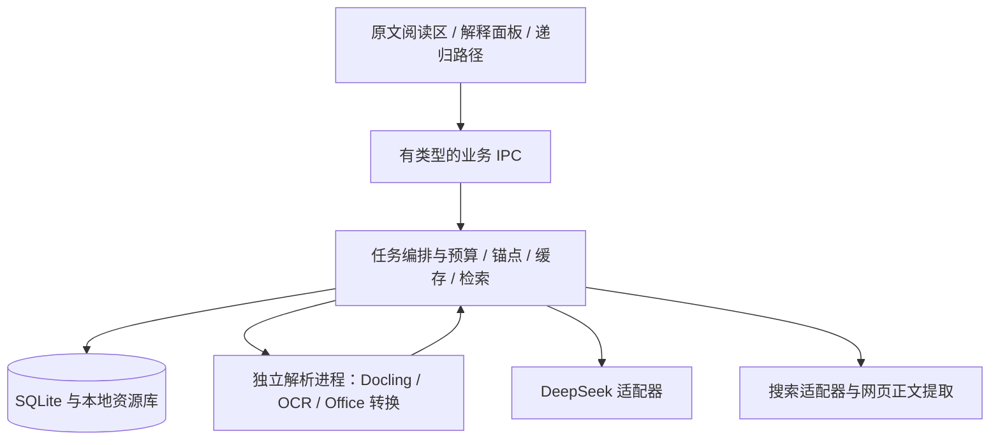

# 系统架构

## 1. 架构决定与边界

默认采用 Windows 优先的本地桌面应用。Electron + React + TypeScript 负责界面与任务编排，SQLite 负责结构数据、任务和全文索引，Python sidecar 提供 Docling/OCR 等重型解析能力。用户不需要手动运行开发服务器或安装 Python 才能使用发布版。

选择 Electron 是为了统一 Chromium 的 PDF 与选区行为，降低早期阅读交互的不确定性；代价是安装包和内存较大。暂不同时维护 Tauri、Web 与浏览器插件三种实现。若真实基准表明资源占用不可接受，再通过架构决策记录评估更换外壳。

重型处理采用独立进程，不阻塞界面。前端仅调用明确的业务 IPC；文件访问、数据库、网络和密钥位于受控的本地服务层。默认不开局域网端口。



这里的流水线阶段是普通程序任务，不要求部署多个自治 AI agent，也不依赖模型之间相互聊天。

## 2. 阅读显示与内容抽取分离

| 格式 | 阅读显示 | 内容抽取和定位 |
| --- | --- | --- |
| 数字 PDF | PDF.js 页面画布、文字层、虚拟化页面 | PDF.js 文本坐标用于原页锚点；Docling 补充结构、表格和阅读顺序；两者显式对齐 |
| 扫描/混合 PDF | 同一 PDF.js 原页；OCR 区域形成选择覆盖层 | 按页/区域检测文本质量，局部 OCR；保存页码、框、旋转变换和原图 |
| Markdown | 安全的 Markdown AST 渲染，支持数学公式 | AST 节点与源文件范围；正文和源码偏移分别保存 |
| TXT | 按段落重排，允许编码选择 | 原始字节保留；解码版本、段落、字符偏移 |
| DOCX | 默认重排阅读；可选转换后的 PDF 原貌视图 | Docling 结构块；必要时读取 OOXML 段落、表格、图片标识以保留映射 |
| PPTX | 默认按幻灯片分组阅读；可选 PDF 页面视图 | Docling 或 OOXML 适配，保留 slide、shape、文本顺序及能取得的备注 |

PDF.js 使用公开 Display/Viewer 接口，worker、字体和 CMap 随应用打包，离线阅读不依赖 CDN。[依据](https://mozilla.github.io/pdf.js/getting_started/)

Docling 用作抽取适配器而非所有格式的视觉阅读器。需用真实样本验证图像、公式、表格及坐标可用性，不能因为扩展名支持就声称保真。[依据](https://docling-project.github.io/docling/usage/supported_formats/)

Office 原貌视图可接入隔离运行的 LibreOffice 转 PDF。该组件是可选依赖，分发和调用前核实许可及安装方式；未安装时 DOCX/PPTX 仍可重排阅读，明确显示“重排视图”。转换可能因字体替换、分页和复杂图形失真，原文件始终保留，不伪造精确页码。

若无法建立 Office 结构块到 PDF 页面的可靠对应，引用返回结构位置或候选页面，不画错误高亮。PPT 动画、视频与复杂图示不能由抽取文字代替；显示原图或不支持提示。禁止静默丢弃并声称已完整解析。

## 3. 文档读入流水线

1. 校验扩展名、真实文件类型、大小和容器解压预算，计算文件内容哈希。
2. 保存原始文件副本或受管理引用；文件更改产生新版本，不覆盖历史依据。
3. 优先展示首屏；解析分批执行，记录各页/块状态。
4. 抽取原生文本和结构。检测无文字、乱码、字符覆盖异常、多栏顺序问题和仅部分页面扫描。
5. 对确有需要的区域执行 OCR，避免全书重复识别和数字文本/OCR 双重入库。
6. 生成统一 Document IR，保留原始文本、规范化文本和偏移映射。
7. 建立目录、全文索引、术语别名索引；可选生成结构预览。
8. 后台检测当前阅读小节疑难点，按预算生成解释。

统一 IR 至少包含：`documentId, revisionId, blockId, kind, rawText, normalizedText, sourceLocator, order, parentBlockId, extractionMethod, extractionVersion, qualityFlags, assetRefs`。

块类型包括标题、段落、列表、公式、表格、图片和说明文字。表格保留行列和合并关系；公式保留原图与识别文本；图和图注互相关联。不能把所有内容压成一条长字符串后丢掉出处。

### OCR 与视觉理解

默认普通文字走可在 CPU 上运行的本地 OCR，语言模型包按需下载且显示体积。中英混排、数学与旋转页面必须分别评测。具体 OCR 引擎由样本准确率、包体和硬件决定，首选通过 Docling 适配的可用引擎，不让大 GPU 成为安装前提。

DeepSeek 图像能力作为可配置的补充路线：用户选择云识别、局部识别质量差、公式或图表需理解时，可上传必要裁剪区域。能力按 endpoint/model 检查，不默认所有 DeepSeek 模型都支持。查阅时 `deepseek-flash` 支持图片，`deepseek-v4-pro` 不支持。[模型表](https://api-docs.deepseek.com/quick_start/pricing/) / [图像指南](https://api-docs.deepseek.com/guides/vision/)

明确区分：OCR 转写、版面坐标、图表含义解释。视觉模型文字转写不能自动视为精确 bbox；未能可靠对齐的结果只能用块级选区或重排文字选区。模型报告的置信度不是校准概率，缺失引擎置信度时使用 null 与具体异常标签。

低质量识别应展示裁剪原图与疑点。符号、单位或上下标影响结论且无法确认时，只解释可确认部分，提供修改转写入口；不按常识悄悄补全。手工修订形成新的文本版本，并使相关解释缓存过期。

## 4. 统一选区与可靠锚点

同一 SelectionService 支持原文 DOM、PDF 文本/OCR 覆盖层和解释正文。

```ts
type SourceAnchor = {
  artifactId: string;        // document 或 explanation 的不可变版本
  artifactKind: 'document' | 'explanation';
  revisionId: string;
  segments: Array<{
    blockId: string;
    start: number;           // 约定 normalizedText 的 Unicode code point 偏移
    end: number;
    quote: string;
    prefix: string;
    suffix: string;
    pageIndex?: number;      // 内部从 0 开始；显示页码单独记录
    rects?: Array<[number, number, number, number]>;
    coordinateSpace?: 'page-normalized-unrotated';
    slideId?: string;
    shapeId?: string;
  }>;
};
```

DOM 的 UTF-16 offset 必须转换，测试 emoji、组合字符、中文和连字。PDF 坐标统一使用未旋转页面的 0–1 比例，显示层负责缩放、裁剪与旋转变换。跨行与跨页选区有多个 segment，不能只存一个矩形。

定位顺序：不可变版本与块 ID → 字符范围校验 → 原句与前后缀候选匹配。新版本中的匹配不唯一则提示重新定位，保留旧版依据，不能静默挂到同名词的另一处。系统可以解释用户选中的字串，但必须说明上下文定位不完整。

生成解释的每个内容 section 有稳定块 ID。修改解释生成新的 revision，旧子节点仍指向旧父版本；重新挂接需显式保存 lineage，不能原地修改造成套娃引用漂移。

## 5. 解释流水线与分级成本

```text
选区 → 锚点解析 → 精确缓存检查
     → 上下文与证据检索 → 简单任务直接生成 / 复杂任务先诊断
     → 按需补充检索 → 教学解释 → 程序校验 → 风险审查与至多一次修订
     → 持久化 → 展示 / 标记未解决项
```

简单术语释义可只调用一次生成；已有章节诊断可复用。复杂论证、多前置、图表或原文疑似错误才增加诊断和独立审查。模型审查是补充检查，不是真实性证明。

默认未命中调用预算建议：普通问题 1 次生成，必要修订最多 1 次；复杂问题最多诊断、写作、审查、修订共 4 次。深搜额外最多 1 次查询规划，可通过本地规则生成补查。OCR 请求单独计入统一预算。数字是首轮配置值，需实测调整。

输入按优先级装配：当前选区与关键上下文、直接定义、必要前置、证据摘录、父解释相关段、读者相关知识、章节概览。预算不足时先剔除低相关来源，不能先删掉原句的成立条件。超长输入按语义分块，显式报告本次覆盖范围。

递归解释的上下文带根原文、当前父段、问题路径摘要及直接证据，不重复发送整棵树。路径摘要只能帮助导航，不替代原证据。

### 预生成策略

优先级：用户请求 > 当前可视小节 > 下一小节 > 显式整章/整书任务。相同任务 single-flight 去重。空闲预取最多相邻一个小节、少量关键疑难点，暂停时不再产生新 API 请求。

关闭窗口后是否继续后台任务由明确设置决定；默认随应用退出停止。本地队列持久化，重启显示可恢复状态，不自动重发已处于未知计费状态的请求。

## 6. 检索与有界深搜

优先检索当前段落和前后定义，其次当前文档，再检索用户显式加入的参考库。生成解释库可以提供术语映射与教学组织，但引用必须追溯其原始证据，不能以“之前的模型回答”证明新回答。

首版全文检索使用 SQLite FTS5，加中英术语别名、章节过滤和应用层中文分词。原文与分词文本分开保存。短中文词通过词典精确匹配与受范围限制的子串检索补充；不能盲用 trigram，因为小于三个字符的全文查询有局限。[FTS5 文档](https://www.sqlite.org/fts5.html)

第二阶段可引入本地多语 embedding 与混合排序。embedding 适配器独立配置，不能假定 DeepSeek 提供 embedding 接口。只有检索评测显示改善才默认启用，不能为架构完整而强加向量数据库。

联网有三种模式：仅资料库、必要时联网、明确深搜。首次配置清楚说明发送的数据类型，按用户设置持久执行，无需每次划选弹确认。

深搜是可核查的检索过程：

1. 定义证据缺口，例如“缺少定理条件”“不知图表单位”“作者观点存在争议”。
2. 用概念与问题检索，不默认把私人教材整段发给搜索服务。
3. 抓取候选正文，保留标题、URL、日期、检索时间与支持片段；搜索摘要只作线索。
4. 优先匹配主张所需的原始材料、正式文档、论文或可靠教材，不按域名数量凑证据。
5. 对冲突证据针对性补查，达到证据充分、无新信息或预算上限即停止。
6. 输出解释与未解决缺口，可点开每条来源的实际支持片段。

建议初始限额：最多 2 轮检索，每轮最多 3 个查询，共读取最多 6 篇正文；有总耗时与 token 上限。用户可主动继续，系统不能无限搜索。

搜索作为独立 SearchProvider，先实现配置好的 SearXNG API，后续可接其他提供方。SearXNG 的 JSON 格式需要实例启用，不能依赖随机公共实例稳定可用。[文档](https://docs.searxng.org/dev/search_api)

DeepSeek 接收检索到的材料生成答案。是否存在提供方内置联网功能由实际接口另行确认，不把聊天产品的联网能力当成 API 自带能力。未配置搜索、超时或无可用证据时明确回退为“仅基于本地材料”，不伪装已深搜。

## 7. 数据模型

| 实体 | 主要内容 |
| --- | --- |
| Document / DocumentRevision | 内容哈希、名称、格式、文件位置、导入时间、版本关系 |
| Block / Asset / Anchor | 结构、原文与规范化映射、图像/表格、可靠定位信息 |
| Concept / ConceptOccurrence | 领域、语境义项、别名、首次定义位置 |
| ConceptEdge | 前置/对比/应用关系，依据位置、来源和待确认状态 |
| LearnerEvidence | 自述背景、接触记录、任务表现、适用范围、时间 |
| Explanation / ExplanationRevision | 根锚点、内容、父节点、任务类型、深度、读者签名、校验状态 |
| Evidence / Citation | 原始材料类型、文档版本或 URL、抓取时间、摘录范围、支持的 claim ID |
| CacheDependency | 缓存条目依赖的源、解释版本、模板、抽取器及语境版本 |
| Job / JobEvent | 状态、预算、优先级、取消、重试、阶段输出、错误 |
| UsageLedger | 请求 ID、模型名/响应版本、输入/输出/缓存 token、估算费用、价格表版本 |

SQLite 单一受控写入入口，事务持久化，带迁移和可备份数据目录。大图片、页面渲染和原文件存对象目录，数据库保存哈希与引用。不要把所有二进制塞入一张解释表。

概念关系是可修正的工作模型，先用关系表即可；不是第一天就建设全学科知识图谱。区分术语第一次出现与正式定义位置。

## 8. 缓存设计

四层缓存独立失效：原始/抽取层、来源证据层、通用概念教学素材层、读者与原句相关的解释层。

解释缓存签名至少覆盖：根文档与选区版本、语境块哈希、父解释版本和当前问题、读者相关前置状态、语言与深度、任务类型、模型配置/能力版本、提示词版本、schema 版本及证据依赖指纹。

采用两阶段查找：先用请求语义和当前上下文构成 request signature 查候选；再校验候选登记的全部依赖版本、检索策略、新鲜度与审核状态。通过后立即返回，不为确认缓存而再调用模型。未命中才检索和生成，最终写入实际 dependency manifest。

相似语义只能用来找候选，不能直接命中最终答案。不同学科同名词、否定句、边界条件不同、同书不同定义和不同掌握水平都需区分。通用素材可复用，但语境化解释仍需校验。

本地精确命中不调用 API。提供方上下文缓存只是另一项成本优化，可把稳定规则和固定材料置于输入前部、动态问题放后部，不发送无关全文来追求命中。[DeepSeek 上下文缓存](https://api-docs.deepseek.com/guides/kv_cache/)

文档修订、OCR 更正、来源撤回和用户纠错触发依赖失效。无关页修改可通过逐块哈希保留可复用素材，但旧版引用不能伪装为新版引用。时间敏感内容按领域设置有效期；永久知识也保留生成与审核日期。用户明确要求“重新核查”时绕过答案缓存并验证来源。

错误回答标记 quarantine，不能进入预生成、相似复用或读者知识证据。其子解释标记“父内容已更正，需检查”，保留历史便于追溯。

缓存空间按原文件、解释、OCR 与网页素材分类展示。清理派生缓存不删除用户批注；删除文档时说明关联内容范围，提供可撤销/备份流程。

## 9. 模型适配、结构校验与任务状态

提供方配置包含 `baseUrl, model, supportsVision, supportsJson, supportsTools, contextLimit, outputLimit, pricingProfile`。只做已核实能力的调用，探测失败明确报错。稳定模型别名可能在提供方更新后改变实际输出，记录响应中可得的版本；无法获知时标为 alias/unknown，不承诺可复现。

JSON 模式只负责语法约束的一部分。应用仍用 schema 校验枚举、长度、引用 ID、锚点、必填字段和截断状态；空返回不作为成功。[官方 JSON 指南](https://api-docs.deepseek.com/guides/json_mode/)

建议任务状态：`queued → extracting/retrieving/diagnosing/generating/validating/reviewing → ready`，并支持 `cancelled / failed / needs_input / incomplete`。阶段不是每次都必须经过，失败记录发生阶段和原因。

第一版流式展示阶段进度，解释包接收完整并验证后原子提交。避免把尚未解析完整的 JSON 直接渲染成正文。后续若需逐节输出，使用带序号的独立可校验 section 事件；未审查正文标为草稿，不进入已验证缓存。

429 等可重试错误退避并遵循 Retry-After；凭证错误不自动重试；输出修复至多一次。超时但提供方可能已接收的请求标记计费状态未知，禁止承诺 exactly-once 或盲目重发。取消尽力终止网络和子任务，但不能承诺撤销已发生费用。

计费按实际 usage 记录，未返回时保留 unknown，不记作零。请求前用可用 tokenizer 或保守估算预留预算，请求后结算；预算覆盖预生成、审查、OCR、搜索等各阶段。图片、推理 token 的计费以当时提供方规则为准，金额显示为估算而非账单。

## 10. 权限与数据流

本地存储不等于模型推理离线。API 请求会把所需片段、相关证据和必要图片发送给配置的服务商；搜索会发送查询。应用应在配置时说清这一点，允许文档级禁止云处理。

API Key 使用操作系统凭据存储/受保护加密，渲染层只获得配置状态；不进日志、源码、导出文件或解释缓存。调试日志默认只含元数据，需要正文时通过明确的本地诊断开关。

文档、网页和模型输出都是非可信内容。Markdown/HTML 清洗、禁用脚本与危险 URL、受限资源协议、IPC 参数和来源校验、renderer sandbox 与 context isolation 必须启用。[Electron 官方建议](https://www.electronjs.org/docs/latest/tutorial/security)

下载网页仅允许经验证的 HTTP(S) 目标，检查重定向和解析后的私网/回环地址，限制大小、类型和超时，防止网页检索被用来访问本地服务。文档内远程图片默认不自动加载。

文件解析器作为隔离子进程运行，限制时间、内存及解压尺寸，不执行 Office 宏、附件脚本或文档指令。PDF/Office 中出现的“忽略上文”“上传密钥”等只是内容，不改变系统权限。

发布前核实每个组件与 OCR 模型权重的许可，生成第三方声明；不能因为库是开源就推断其所有模型资源许可相同。

## 11. 建议工程结构与协议

```text
apps/desktop/              Electron main、preload、React renderer
packages/core/             编排、预算、缓存、选区和来源解析
packages/contracts/        schema、IPC、任务事件和文档 IR
packages/readers/          PDF 与 DOM 适配器
packages/providers/        DeepSeek、搜索、可选 embedding
packages/storage/          SQLite 迁移、repositories、全文索引
services/parser/           Python sidecar 与 OCR/Office 适配器
prompts/                   可版本化模板和少量领域示例
evals/                     有许可的测试材料、期望检查项与运行器
tests/                     单元、集成、端到端
docs/                      当前设计和架构决策记录
```

Python sidecar 使用 stdio JSON Lines，含 request ID、schemaVersion、operation、进度/结果/错误与 cancel。 stdout 只放协议，日志走 stderr；路径由主进程从文档 ID 解析，前端不能传任意可执行命令。

关键业务接口：`importDocument`、`getDocumentStatus`、`getBlocks`、`resolveAnchor`、`explainSelection`、`explainChildSelection`、`getJob`、`cancelJob`、`searchLibrary`、`updateTranscription`、`recordLearningEvidence`、`exportAnnotations`。

`explainSelection` 输入锚点、可选明确问题、读者签名、深度和联网模式；输出缓存命中解释或 job ID。所有异步事件带 job ID 与递增 sequence，前端丢弃陈旧事件，避免切换文档后混入旧答案。
