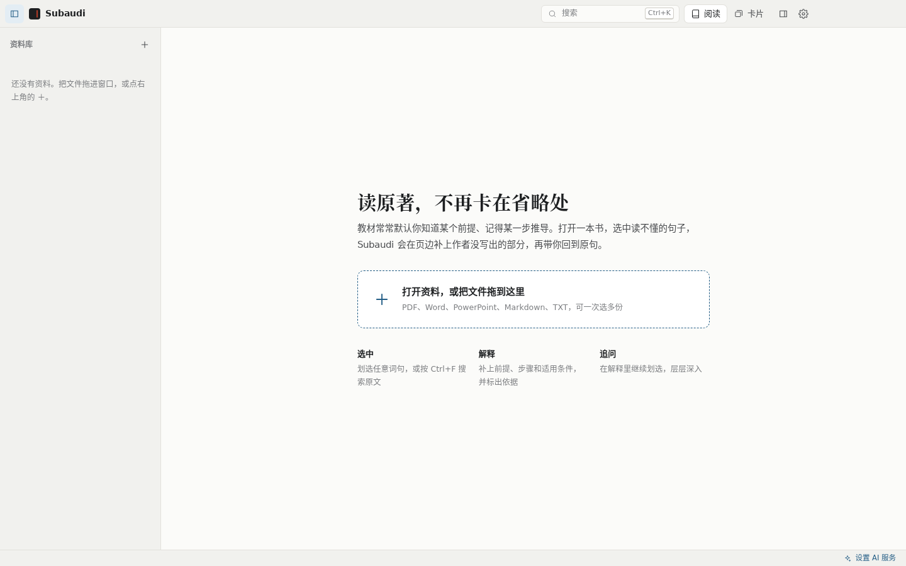
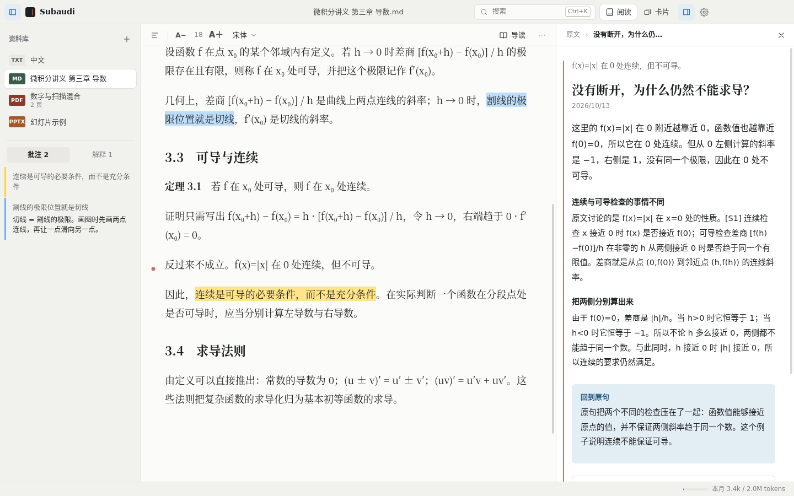
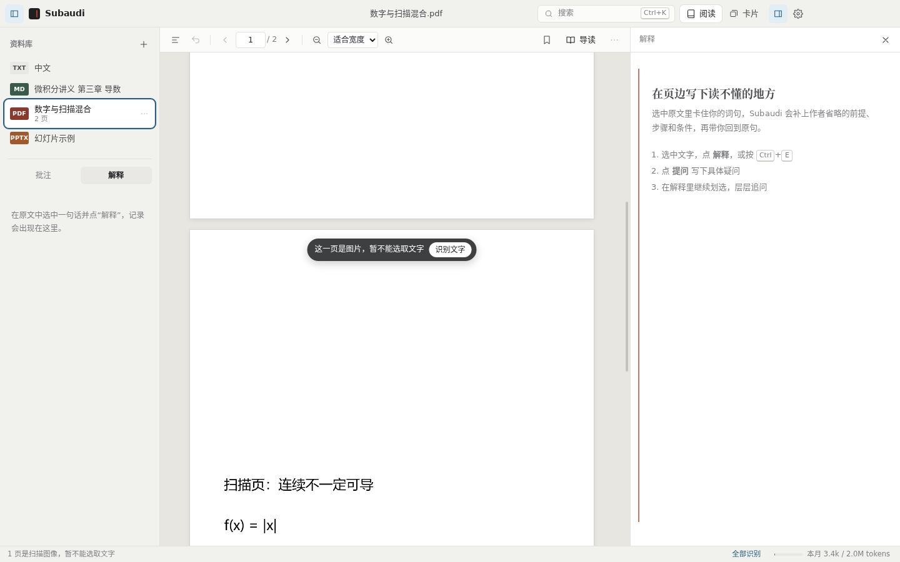
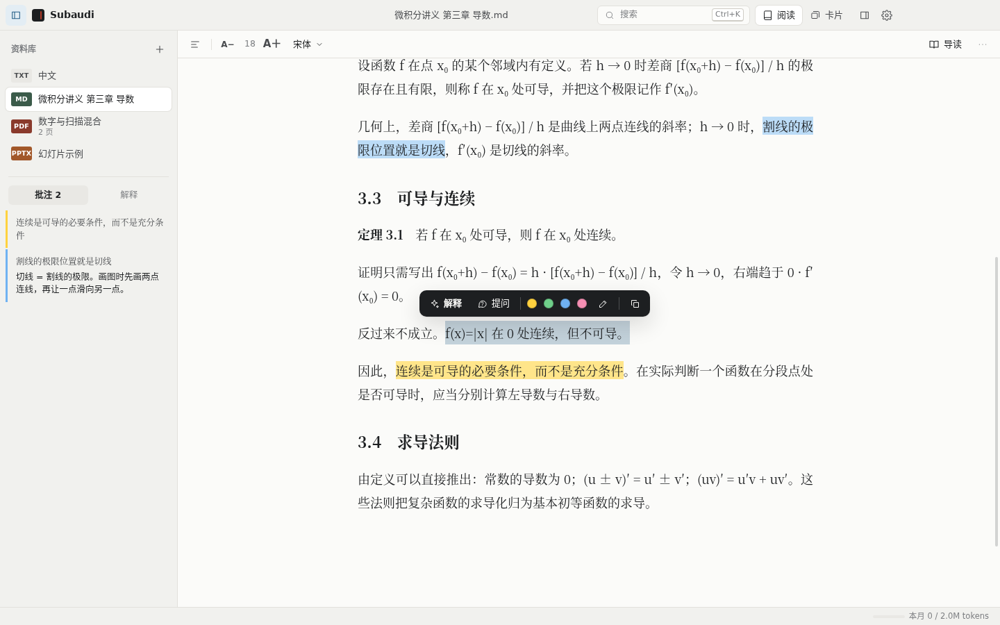
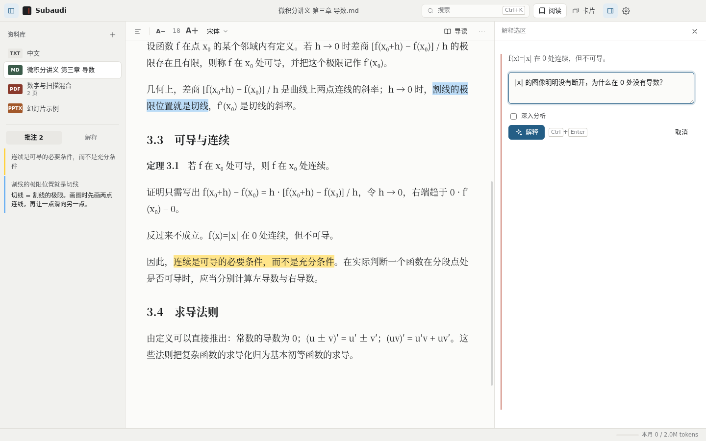
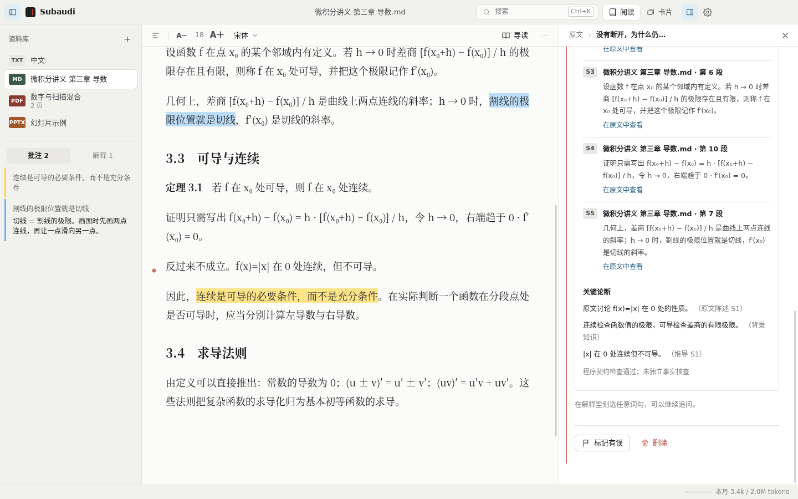
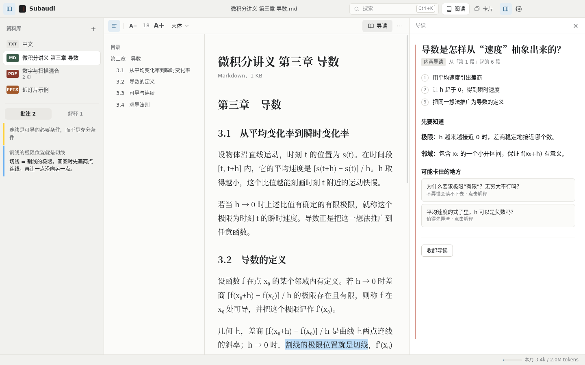
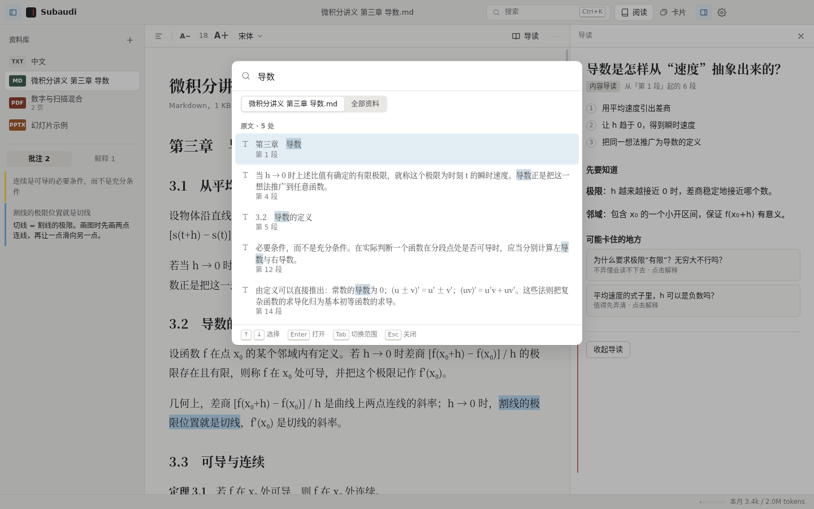
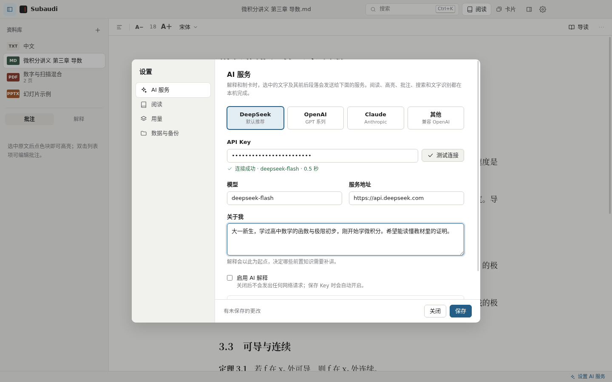
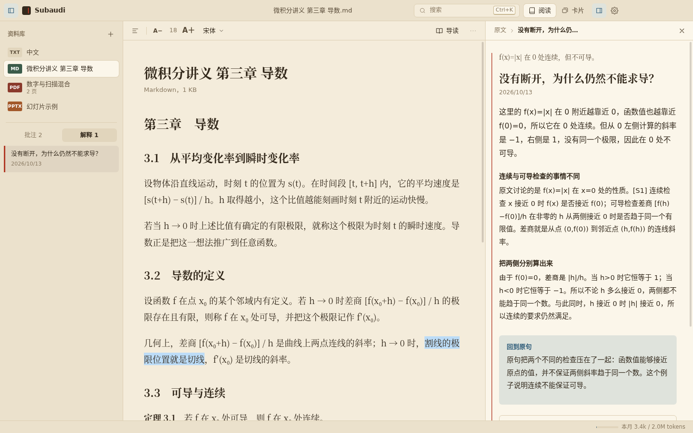

# Subaudi 使用手册

适用版本：0.2.0（Windows 10 / 11，64 位）

---

## 目录

1. [Subaudi 是做什么的](#1-subaudi-是做什么的)
2. [安装与首次启动](#2-安装与首次启动)
3. [界面一览](#3-界面一览)
4. [导入资料](#4-导入资料)
5. [阅读](#5-阅读)
6. [解释：读懂卡住的句子](#6-解释读懂卡住的句子)
7. [导读：先看清这一部分的路线](#7-导读先看清这一部分的路线)
8. [高亮与批注](#8-高亮与批注)
9. [搜索与命令面板](#9-搜索与命令面板)
10. [卡片库](#10-卡片库)
11. [设置](#11-设置)
12. [隐私：哪些内容会离开你的电脑](#12-隐私哪些内容会离开你的电脑)
13. [数据存储、备份与迁移](#13-数据存储备份与迁移)
14. [快捷键](#14-快捷键)
15. [常见问题与故障排除](#15-常见问题与故障排除)
16. [已知限制](#16-已知限制)

---

## 1. Subaudi 是做什么的

教材和论文的作者常默认读者已经知道某个前提、记得某一步推导、明白某个条件为什么必要。专家能自己补上这些空缺，初学者往往就卡在这里。

Subaudi 是一个本地阅读器。你选中读不懂的词句，它会在页边写一条“眉批”：

- 说明这句话**在这里**是什么意思（而不是脱离语境的词条释义）；
- 补上作者省略的前置知识、推导步骤和适用条件；
- 标出每个论断的依据：来自原文、来自推导，还是一般背景知识；
- 最后带你**回到原句**，告诉你这句话现在应该怎样理解。

读懂之后，你可以在解释里继续划选追问，也可以把整份资料做成问答卡片，用间隔重复的方法复习。

阅读、高亮、批注、搜索、文字识别和卡片复习都在你的电脑上完成。只有“解释”“导读”和“从资料制卡”会把相关文字发送给你自己配置的 AI 服务（见[第 12 章](#12-隐私哪些内容会离开你的电脑)）。

---

## 2. 安装与首次启动

### 系统要求

- Windows 10 或 Windows 11，64 位
- 约 1 GB 可用磁盘空间
- 使用 AI 功能时需要联网，以及一个 AI 服务的 API Key（DeepSeek、OpenAI、Anthropic，或任何兼容 OpenAI 接口的服务）

不需要安装 Python、Office 或其他运行环境，文档解析、文字识别和卡片库内核都已随程序打包。

### 安装

Subaudi 是便携版程序，下载 `Subaudi-版本号.exe` 后双击即可运行，无需安装。

当前发布包没有代码签名。第一次运行时 Windows 可能弹出“Windows 已保护你的电脑”：点 **更多信息** → **仍要运行**。

### 首次启动

第一次打开会看到欢迎页。点中间的大按钮选择文件，或者直接把文件拖进窗口。

建议首次使用时按这个顺序来：

1. 打开一份正在读的教材；
2. 按 `Ctrl+,` 打开设置，粘贴 API Key，点 **测试连接**，再 **保存**（见 [11.1](#111-ai-服务)）；
3. 在原文中选中一句读不懂的话，点 **解释**。

---

## 3. 界面一览

| 区域 | 位置 | 作用 |
| --- | --- | --- |
| 标题栏 | 顶部 | 侧栏开关、当前资料名、搜索框（`Ctrl+K`）、**阅读 / 卡片** 视图切换、解释栏开关、设置 |
| 资料库 | 左侧 | 所有已导入的资料；下方是当前资料的 **批注** 和 **解释** 列表 |
| 阅读区 | 中间 | 阅读工具栏 + 正文或 PDF 页面 |
| 解释栏（页边） | 右侧 | 解释、提问、导读都显示在这里；左侧的红线就是“页边” |
| 状态栏 | 底部 | 后台任务进度（建立文字索引、识别扫描页、正在解释）、扫描页提示、本月 AI 用量 |

侧栏和解释栏都可以随时收起，让正文占满窗口：`Ctrl+\` 切换侧栏，`Ctrl+J` 切换解释栏。

---

## 4. 导入资料

### 导入方式

- 点资料库右上角的 **＋** → **打开资料…**
- 按 `Ctrl+O`
- 把文件从资源管理器**拖进窗口**的任意位置

文件对话框和拖拽都支持一次导入多份资料。单个文件最大 1 GB。

Subaudi 会在自己的数据目录里保存一份私有副本，之后移动、重命名或删除原文件都不影响阅读。从资料库移除资料时，只删除这份私有副本，你电脑上的原文件不受影响。

同一个文件（按内容判断，与文件名无关）重复导入时，会直接打开已有的记录，批注和解释都在。

### 支持的格式

| 格式 | 显示方式 | 说明 |
| --- | --- | --- |
| PDF | 原版式逐页显示 | 有文字层的页可直接选取；扫描页需要先识别文字（见 [5.3](#53-扫描页与文字识别)） |
| Word（.docx） | 重排为正文 | 保留段落与表格；内嵌图片集中显示在文末，不保证与原位置对应 |
| PowerPoint（.pptx） | 按播放顺序重排 | 保留每页文字、表格、图片和演讲者备注；图表、动画和原始布局不保留 |
| 旧版 PowerPoint（.ppt） | 按播放顺序重排 | 只提取文字 |
| Markdown（.md） | 渲染为排版正文 | 网络图片不加载；链接显示为普通文字；内嵌 HTML 被忽略 |
| 纯文本（.txt） | 按空行分段 | 自动识别 UTF-8 与 GBK 编码 |

### 参考资料

资料库 **＋** → **添加参考资料…** 导入的资料会标记为“参考资料”。解释其他资料时，Subaudi 会在参考资料里检索与选区相关的段落，作为补充依据一并提供给 AI。

适合放进参考资料的通常是：同一门课的另一本教材、讲义、术语表、课程笔记。

### 资料菜单

鼠标移到资料名上，点右侧的 **…**（或右键单击）：

| 菜单项 | 作用 |
| --- | --- |
| 用系统程序打开 | 用 Windows 默认程序打开这份资料（例如在 Word 里看原始排版） |
| 允许 AI 读取这份资料 | 勾选时可以解释、导读、制卡；取消后这份资料设为“仅本地”，其中任何文字都不会发送给 AI |
| 从资料库移除 | 同时删除这份资料的批注和解释；原文件不受影响 |

“仅本地”的资料在列表中会注明。

---

## 5. 阅读

### 5.1 文字类资料（Word、PowerPoint、Markdown、TXT）

文字类资料会重排成一栏便于阅读的正文。阅读工具栏从左到右依次是：

- **目录**：按资料的标题层级生成；演示文稿按幻灯片生成。滚动时当前章节会高亮。
- **A− / A＋**：调整正文字号（14–26）。
- **字体**：宋体、黑体、楷体。
- **导读**：见[第 7 章](#7-导读先看清这一部分的路线)。
- **…**：用系统程序打开原文件。

演示文稿每页之前有“第 N 张幻灯片”分隔线；演讲者备注以缩进的灰色文字显示在该页之后。

已经解释过的段落，左侧页边会出现一个红点，点一下即可打开那条解释。

行宽、主题等更多阅读选项在 **设置 → 阅读** 中（见 [11.2](#112-阅读)）。

### 5.2 PDF

PDF 工具栏从左到右：

| 按钮 | 作用 |
| --- | --- |
| 目录 | 打开左侧的目录与书签栏。目录来自 PDF 自带的书签；没有内置目录的 PDF 只显示你的书签 |
| 返回 | 点目录、书签、搜索结果或文内链接跳转后，回到跳转前的页 |
| ‹ 页码 / 总页数 › | 上一页、下一页；在页码框里输入数字后按 `Enter` 跳转 |
| − 缩放 ＋ | 缩小、放大；下拉框可选 **适合宽度**、**整页** 或固定比例 |
| 书签 | 为当前页加书签或移除书签；书签显示在目录栏底部，右键单击书签可删除 |
| 导读 | 见[第 7 章](#7-导读先看清这一部分的路线) |
| … | 连续滚动 / 单页、旋转页面、本页文字、识别本页文字、导出带批注的 PDF、用系统程序打开 |

翻页和缩放：

- `←` / `→` 翻页，`Home` / `End` 到首页、末页；
- `PageDown` / `空格` 向下滚动一屏，`PageUp` / `Shift+空格` 向上（单页模式下为翻页）；
- `Ctrl+滚轮` 以鼠标位置为中心缩放；`Ctrl+=`、`Ctrl+-` 放大缩小，`Ctrl+0` 恢复适合宽度。

PDF 中的文内链接（如目录页码、参考文献引用）可以点击跳转；外部网址会用浏览器打开。PDF 原有的批注（便签）以黄色小方块显示在页边，点开可看内容。

打开一份新 PDF 时，Subaudi 会在后台逐页提取文字、建立索引，状态栏显示进度。这不影响阅读；建立索引之前，搜索和制卡可能找不到尚未处理的页。

### 5.3 扫描页与文字识别

扫描版 PDF 的页面只是图片，不能选取文字，也就无法解释、高亮或搜索。Subaudi 会自动发现这些页：

- 页面顶部出现提示条“这一页是图片，暂不能选取文字”，点 **识别文字** 识别这一页；
- 底部状态栏显示“N 页是扫描图像”，点 **全部识别** 依次识别所有扫描页，可以随时点 **停止**；
- 也可以在工具栏 **…** → **识别本页文字**。有少量文字层但主要是图片的页面，也可以用这个菜单重新识别。

识别在本机进行，不上传图片。第一页需要几秒钟加载识别模型，之后每页通常只需几秒。识别完成后，这一页可以像普通 PDF 一样选取文字、解释、高亮和搜索。

识别结果难免有错，数学符号、上下标和表格尤其容易出错。**… → 本页文字** 可以查看这一页的文字；点 **修正** 可以直接编辑并保存。修正或重新识别后，引用过这一页的解释会被标记为“已标记有误”，提醒你核对后重新解释。

### 5.4 阅读位置

Subaudi 会记住你上次打开的资料、解释和阅读位置。每份 PDF 记住各自的页码，文字类资料记住滚动位置。

---

## 6. 解释：读懂卡住的句子

### 6.1 准备

解释需要先配置 AI 服务。还没配置时，点 **解释** 后解释栏会提示你打开设置，粘贴 Key 并保存即可（详见 [11.1](#111-ai-服务)）。

建议同时填写 **设置 → AI 服务 → 关于我**，写下你学过什么、想读懂到什么程度。解释会以此为起点，决定哪些前置知识需要补讲、哪些可以略过。

### 6.2 选中文字

在正文里拖动鼠标选中一个词、一句话或几段话，选区上方会出现工具条：

| 按钮 | 作用 |
| --- | --- |
| **解释** | 直接解释这段文字在这里的意思（快捷键 `Ctrl+E`） |
| **提问** | 先写下你具体的疑问，再解释 |
| 四个色块 | 用黄、绿、蓝、粉高亮 |
| 笔 | 高亮并添加批注 |
| 复制 | 复制选中的文字 |

也可以在选区上**单击右键**调出同样的工具条。

一次选区最多跨 20 段、6000 字，不能同时跨两份资料。选得越准，解释越有针对性：卡在一个符号上就只选那个符号所在的句子，不要整页全选。

### 6.3 解释与提问

**解释**：不需要额外输入，Subaudi 会说明这段文字在当前语境下的含义。

**提问**：点 **提问** 后，解释栏出现输入框。写下你真正困惑的地方，例如：

- “这里为什么要求 h ≠ 0？”
- “第二个等号是怎么来的？”
- “这个结论对离散的情况也成立吗？”

然后点 **解释** 或按 `Ctrl+Enter`。问题越具体，解释越能直击卡点。输入框留空时，效果与直接点 **解释** 相同。

输入框下方还有两个选项：

- **深入分析**：先分析选区缺了哪些前提和条件，生成解释后再让 AI 自审一轮，必要时修订。更慢，调用次数更多，适合证明、推导、论证链这类“差一步就全错”的内容。
- **联网检索**：只有在设置中配置了 SearXNG 检索服务后才会出现。填入检索词后，Subaudi 会用这个词检索公开网页，读取最多 3 个网页的正文作为补充依据。只有检索词会发给检索服务。

解释过程中，解释栏显示当前步骤（分析选区、生成解释、审查解释……），可以随时点 **停止**。已经发出的请求可能仍会被服务商计费。

### 6.4 读懂一条解释

一条解释从上到下依次是：

| 部分 | 内容 |
| --- | --- |
| 引文 | 你选中的原文，点击可回到原文位置 |
| 标题 | 用一句话点出关键疑惑 |
| 标签 | “资料有限”表示依据不足、结论有所收窄，或审查、修订步骤没能完成（原因列在解释末尾的“尚未解决”中）。带这个标签的解释照常保存，但不会被自动复用，下次选中同一段会重新生成；“已标记有误”见 [6.6](#66-管理解释) |
| 简答 | 最先读的一段，直接回答“这里是什么意思” |
| 小节 | 按需要展开：含义、目的、前置知识、推导机制、例子、适用边界、对比等，不会每次都凑满 |
| 回到原句 | 作者省略了什么，这句话现在应该怎样理解 |
| 待解决 | 资料不足以确认的地方，以及建议的下一步 |
| 自测一下 | 一道换了条件的小题，提示和答案分别折叠，先想再看 |
| 依据 | 折叠面板，见下文 |

**依据**面板列出这条解释参考的全部来源：

- **S1** 是你选中的原文；**S2、S3……** 是从当前资料和参考资料中检索到的相关段落；联网检索得到的网页也会列在这里。点 **在原文中查看** 跳到对应位置。
- **关键论断** 列出解释中的主要断言，并注明依据类型：
  - **原文陈述**：原文直接这样说；
  - **推导**：由前面的小节推出，可以自己检查推导过程；
  - **背景知识**：一般学科知识，原文中没有，也未经检索核实；
  - **解读**：对原文意图或含义的理解，可能存在其他读法；
  - **不确定**：无法确认，正文已相应收窄。
- 最下方的一行小字说明这条解释经过了哪些检查。程序会核对解释的结构和引用编号是否自洽，但**不能保证内容正确**。重要结论请回到原文和教材核对。

正文中出现的 [S1]、[S2] 即对应这里的来源编号。

### 6.5 追问

在解释的正文里同样可以划选文字，点 **解释** 或 **提问** 继续追问。追问的结果是一条新解释，它会记住自己是从哪条解释、哪句原文出发的。

解释栏顶部的路径（例如“原文 › 没有断开，为什么仍然不能求导？ › 差商”）显示当前所在的层级。点其中任意一层即可返回；点 **原文** 回到最初选中的原文。

### 6.6 管理解释

左侧资料库下方的 **解释** 列表列出当前资料的全部解释，最新的在最上面。追问会注明“追问”。

- **标记有误**：发现一条解释有错时，点解释底部的 **标记有误**。它和从它出发的所有追问都会被标记，以后选中同一段文字时不会再直接复用，而会重新解释。
- **删除**：点解释底部的 **删除**，或在列表中右键单击。从它出发的追问会一并删除。

### 6.7 什么时候会调用 AI

同一段选区、同样的问题、同样的设置，再次解释时直接打开已有结果，不调用 API，也不消耗用量。

带联网检索的解释只在 24 小时内复用。以下情况会生成新解释：

- 修改了问题或检索词，或切换了“深入分析”；
- 修改了“关于我”、模型、服务地址或检索服务；
- 解释被标记有误，或引用的原文页被修正、重新识别。

一次普通解释最多调用 3 次模型；深入分析最多 5 次。实际用量记录在 **设置 → 用量**。

---

## 7. 导读：先看清这一部分的路线

开始读新的一节之前，点阅读工具栏的 **导读**。

导读会读取从当前位置开始的最多 6 段原文，给出：

- 这一部分要回答的核心问题；
- 论述路线：先讲什么、再讲什么；
- 读之前需要知道的概念；
- **可能卡住的地方**：点任意一条，就会针对对应的原文段落和这个问题直接生成解释。

“当前位置”在文字类资料中是你正在阅读的章节，在 PDF 中是当前页。导读结果会缓存，同一位置再次打开不再调用 API。点 **收起导读** 关闭。

---

## 8. 高亮与批注

### 高亮

选中文字后点工具条上的色块，即可用对应颜色高亮。颜色没有固定含义，可以自己约定，例如黄色标重点、绿色标定义、蓝色标例子、粉色标疑问。

### 批注

选中文字后点工具条上的笔，弹出批注框：选颜色、写想法，点 **保存** 或按 `Ctrl+Enter`。

PDF 上带文字的批注会在页边显示一个红色小图钉，点击即可查看和编辑。

### 管理

左侧资料库下方的 **批注** 列表按资料列出全部高亮和批注，左边的色条对应高亮颜色：

- **单击**：跳到原文位置；
- **双击**：编辑批注、改颜色或删除；
- **右键**：编辑或删除。

高亮和批注只能加在原文上，不能加在解释里。

### 导出带批注的 PDF

PDF 工具栏 **…** → **导出带批注的 PDF**，会另存一份新的 PDF，原文件不变。高亮会写成标准的 PDF 高亮注释，批注文字写在注释内容中，在 Adobe Acrobat、Edge、福昕等阅读器里都能看到和编辑。

---

## 9. 搜索与命令面板

按 `Ctrl+K`，或点标题栏的搜索框，打开搜索与命令面板。

**搜索原文**：输入关键词，面板列出所有出现的位置，命中处高亮显示。用 `↑` `↓` 选择，`Enter` 跳转，原文中对应段落会短暂高亮。

- 打开某份资料时，默认只搜这份资料；按 `Tab` 或点面板上方的切换按钮，可以改为搜索全部资料；
- 先选中一段文字再按 `Ctrl+F`，会直接用选中的文字搜索；
- 搜索不区分英文大小写，按字面匹配，不是语义搜索。PDF 只能搜到已建立文字索引的页，扫描页需要先识别文字。

**命令**：面板同时列出常用操作，输入几个字即可筛选并执行，例如“打开资料”“卡片库”“主题：夜间”“导读”“查看用量”“导出备份”。

---

## 10. 卡片库

点标题栏的 **卡片** 进入卡片库，点 **阅读** 或按 `Esc` 返回。

卡片库内置官方 Anki 内核（26.9.3），新牌组默认使用 FSRS 调度算法，复习间隔、学习记录和撤销都由 Anki 内核计算。卡片库和桌面版 Anki 的牌组文件可以互相导入导出。

左侧是牌组列表，牌组名右侧的绿色数字是今天到期的卡片数，蓝色数字是新卡数。

### 10.1 复习

1. 在左侧选一个牌组，进入 **复习**，第一张卡片会自动出现；
2. 先回忆答案，再点 **显示答案** 或按 `空格`；
3. 按你回忆的情况评分：

| 按钮 | 快捷键 | 什么时候用 |
| --- | --- | --- |
| 重来 | `1` | 没想起来，或者想错了 |
| 困难 | `2` | 想起来了，但很吃力 |
| 良好 | `3`（或 `空格`） | 稍作思考后想起来了 |
| 简单 | `4` | 立刻想起来，毫不费力 |

每个按钮下方显示选择它之后下次复习的间隔。顶部显示本轮剩余的新卡、学习中和待复习卡片数。

- **撤销评分**：评错了，点工具栏的 **撤销评分**，回到上一张卡片；
- 卡片右上角的 **…**：编辑、暂停复习、移动到其他牌组、删除笔记。

切回阅读视图时，答题计时会暂停，回来后可以接着答。

### 10.2 浏览

**浏览** 列出牌组中的所有卡片，每页 100 张。它是为快速过一遍卡片设计的：打开时默认 **问答同屏**，问题和答案在同一页里，不用逐张翻面。

- 搜索框支持 Anki 搜索语法，例如 `is:due`（到期）、`is:new`（新卡）、`tag:重点`、`tag:待核对`、`deck:微积分`、`"导数"`；
- 点一张卡片查看；用 `↑` `↓` 或右上角的箭头在列表中连续翻看，不用回到左侧列表点击；
- 右上角可在 **问答同屏**（默认，便于快速浏览）和 **正面**（只看问题，便于自测）之间切换，按 `空格` 也能切换；
- **…** → **编辑**：修改各字段和标签（标签用空格分隔）。编辑的是笔记，同一条笔记生成的所有卡片会一起更新；
- **删除笔记**：会同时删除它生成的所有卡片和复习记录。删除前会自动备份卡片库。

### 10.3 从资料制卡

**从资料制卡** 会为你在阅读视图中打开的那份资料逐段梳理知识点，为每个知识点生成至少一张问答卡。

1. 先在阅读视图中打开要制卡的资料；
2. 进入卡片库 → **从资料制卡**；
3. 填写 **放入牌组**（默认是资料名；不存在的牌组会自动创建，用 `::` 分隔可建子牌组，例如 `微积分::第三章`）；
4. 点 **开始制卡**。

制卡的过程：

- 资料按约 2,400 字分批。每批先列出全部可考查的知识点（定义、定理、机制、公式及其条件、步骤、对比、边界与例外），再逐组生成卡片；
- 每张卡片的背面附有资料名、位置和原文引文，方便回查；
- 卡片自动带标签 `Subaudi`、`自动生成`，以及 `重点`（理解后续内容必需）或 `巩固`（例证与补充）；
- Subaudi 会在原文中核对每张卡片的引文。找不到的卡片不会丢弃，而是加上 `待核对` 标签照常保存，背面注明“未能在原文中找到这段引文”。制卡结束时的提示里点 **查看待核对**，或在浏览中搜索 `tag:待核对`，即可逐张检查、修改或删除；
- 个别知识点漏制、个别响应格式出错时，制卡不会中断：会先自动补制或重试一次，仍不成功的就跳过，结束时一并列出。被跳过的批次再点一次 **开始制卡** 会重试；
- 进度显示在按钮下方，可以随时 **停止**。已完成的部分会保留；再次点 **开始制卡** 时会跳过已完成的批次，不会重复生成卡片。

注意：

- 制卡会把资料的**全部正文**发送给 AI 服务，计入本月用量。一本书可能需要数十万 tokens，建议先用一章试试效果；
- PDF 需要等文字索引全部建立完成后才能制卡（状态栏显示“文字索引完成”）；扫描页会在制卡前自动识别；
- 资料中没有转成文字的图片、图表和公式不会进入卡片。

### 10.4 导入、导出与备份

工具栏的 **导入** 支持三种 Anki 文件：

| 格式 | 说明 |
| --- | --- |
| `.apkg` | 牌组包，最常见的共享格式 |
| `.colpkg` | 完整卡片库备份。会**合并**进当前卡片库，不会覆盖已有内容 |
| `.anki2` | Anki 的数据库文件。导入前请先关闭正在使用它的桌面版 Anki；同名的 `.media` 文件夹会一起导入 |

导入前会自动备份当前卡片库。单个文件最大 512 MB。

工具栏 **…** 中还有：

- **导出当前牌组…**：导出为 `.apkg`，包含媒体文件；
- **导入/导出时包含复习进度**：默认不勾选，适合分享牌组或导入他人的牌组；导入导出你自己的牌组时勾选，可以保留学习进度；
- **重命名牌组**；
- **备份整个卡片库…**：导出为 `.colpkg`，包含全部牌组、媒体和复习进度；
- **打开卡片库文件夹**。

### 10.5 与桌面版 Anki 配合

Subaudi 不支持 AnkiWeb 同步，也不能编辑笔记类型模板。如果需要这些功能，可以导出 `.apkg` 或 `.colpkg`，在桌面版 Anki 中导入。

卡片在安全沙箱中显示，依赖 JavaScript 的自定义模板、Anki 插件和自动公式渲染（MathJax）不保证能正常显示。

---

## 11. 设置

按 `Ctrl+,`，或点标题栏右侧的齿轮图标打开设置。

### 11.1 AI 服务

**选择服务商**：点上方的卡片会自动填好服务地址和默认模型。

| 服务商 | 服务地址 | 默认模型 |
| --- | --- | --- |
| DeepSeek | `https://api.deepseek.com` | `deepseek-flash` |
| OpenAI | `https://api.openai.com/v1` | `gpt-4.1-mini` |
| Claude | `https://api.anthropic.com/v1` | `claude-sonnet-4-6` |
| 其他 | 自行填写 | 自行填写 |

“其他”适用于任何兼容 OpenAI Chat Completions 接口的服务，包括各类中转服务和本地部署的模型。模型名以服务商当前提供的为准，可以随时修改。

**API Key**：粘贴你在服务商网站申请的 Key。Key 由 Windows 系统加密后保存在本机，不会显示在界面上，也不会写入导出的备份文件。每个服务地址分别保存各自的 Key，切换服务商时不需要重新粘贴。

**测试连接**：用当前填写的 Key、地址和模型发送一次极小的请求。成功时显示模型名和响应时间；失败时显示具体原因（Key 无效、余额不足、模型名错误等）。建议保存前先测试一次。

**关于我**：描述你的背景和目标。例如：

> 大一学生，学过高中数学，刚开始学微积分。希望能独立读懂教材里的证明。

> 软件工程师，熟悉编程但没系统学过概率论。读这本书是为了理解机器学习论文里的推导。

写得越具体，解释越能对准你的水平。

**启用 AI 解释**：关闭后，Subaudi 不会发出任何 AI 请求。保存 Key 时会自动开启。

**高级**（折叠）：

- **接口协议**：OpenAI Chat Completions 或 Anthropic Messages。选服务商时会自动设置；
- **JSON 模式**：要求模型严格返回 JSON。如果服务返回“400 请求参数不被支持”，可以尝试关闭；
- **联网检索（SearXNG）**：填写你可用的 SearXNG 实例地址（需开启 JSON 输出格式）。配置后，提问时可以使用联网检索。

修改后点右下角 **保存**。

### 11.2 阅读

- **主题**：明亮、护眼（米黄纸色）、夜间。夜间主题下 PDF 页面也会反色显示；
- **正文字体**：宋体、黑体、楷体；
- **字号**：14–26；
- **行宽**：每行 28–56 个字。

这些设置立即生效，只影响文字类资料的正文排版，PDF 保持原版式。

### 11.3 用量

用量按自然月统计，每月 1 日自动清零：

- 上方显示本月已用 tokens 和上限；
- **每月上限** 默认 200 万 tokens。达到上限后暂停新的 AI 请求，下月自动恢复。填 `0` 表示不限；
- 下方的账本列出本月每次请求的时间、任务（解释、分析、审查、修订、导读、制卡）、模型和 tokens。数字前带“≈”表示服务商没有返回用量，按估算值记录。

底部状态栏右侧也会显示本月用量，点击即可打开这一页。

这个上限是 Subaudi 自己的限制，不是服务商账户的消费上限。实际费用请以服务商账单为准。

### 11.4 数据与备份

- **导出备份**：把全部资料的文字、批注和解释保存为一个 JSON 文件。不含原文件和 API Key；
- **从备份恢复**：把备份文件合并进来，不会覆盖现有内容。如果备份里的资料在本机没有对应的原文件，会以“备份快照”的形式只显示文字；重新导入原文件即可恢复原版式。备份中个别记录损坏或来自更新版本、无法识别时，只跳过这几条，其余照常恢复，跳过的数量会在提示中列出；
- **打开数据文件夹**：见[第 13 章](#13-数据存储备份与迁移)。

导出备份不包含卡片库。卡片请在卡片库中单独 **备份整个卡片库**。

---

## 12. 隐私：哪些内容会离开你的电脑

**始终只在本机**：

- 所有资料文件及其私有副本；
- 阅读位置、高亮、批注、书签；
- 文字识别（扫描页图像不会上传）；
- 搜索；
- 卡片库与复习记录；
- API Key（系统加密保存）。

**使用 AI 功能时发送给你配置的服务**：

| 功能 | 发送的内容 |
| --- | --- |
| 解释 / 提问 | 选中的文字；所在段落及前后各一段；从当前资料和参考资料中检索到的最多 4 段相关文字；追问时还包括上层解释；你写的问题；“关于我” |
| 导读 | 从当前位置起最多 6 段原文；“关于我” |
| 从资料制卡 | 资料的全部正文 |
| 联网检索 | 只把你填写的检索词发给你配置的 SearXNG 服务；Subaudi 随后读取最多 3 个公开 HTTPS 网页，不会访问本机或局域网地址 |
| 测试连接 | 一条固定的测试消息 |

不会发送：未被选中且未被检索到的其余原文（制卡除外）、你的批注、文件名以外的文件信息、其他资料（除非已加入参考资料且允许 AI 读取）。

想让某份资料完全不参与 AI 处理，在资料菜单中取消 **允许 AI 读取这份资料**。想彻底关闭 AI，在 **设置 → AI 服务** 中取消 **启用 AI 解释**。

请确认你有权把资料内容发送给第三方服务，并了解所用服务商的数据政策。

---

## 13. 数据存储、备份与迁移

### 数据在哪里

所有数据保存在 `%APPDATA%\Subaudi`（在 **设置 → 数据与备份 → 打开** 可以直接打开）：

| 文件或文件夹 | 内容 |
| --- | --- |
| `subaudi.sqlite`（及同名 `-wal`、`-shm` 文件） | 资料文字、索引、批注、解释、用量、设置 |
| `objects\` | 导入资料的私有副本 |
| `anki\` | 卡片库（`collection.anki2`、媒体文件、`backups\` 自动备份） |
| `credential*.bin` | 加密的 API Key |

Subaudi 运行时请不要手动修改这些文件。

### 完整备份

1. 退出 Subaudi；
2. 复制整个 `%APPDATA%\Subaudi` 文件夹。

只复制 `subaudi.sqlite` 而漏掉同名的 `-wal` 文件，可能丢失最近的修改。

### 迁移到新电脑

1. 在旧电脑上做一次完整备份；
2. 在新电脑上运行一次 Subaudi 后退出，用备份覆盖新电脑上的 `%APPDATA%\Subaudi`；
3. 打开 Subaudi，在设置中重新粘贴 API Key。

`credential*.bin` 由 Windows 按当前用户加密，换电脑或换 Windows 用户后无法解密，需要重新填写 Key。把备份分享给别人之前，请删除这些文件。

另一种方式：用 **导出备份**（文字、批注、解释）加 **备份整个卡片库**（卡片）迁移，再在新电脑上重新导入原文件。

---

## 14. 快捷键

### 全局

| 快捷键 | 作用 |
| --- | --- |
| `Ctrl+O` | 打开资料 |
| `Ctrl+K` | 搜索与命令面板 |
| `Ctrl+F` | 搜索（用选中的文字作为关键词） |
| `Ctrl+E` | 解释选中的文字（选区工具条显示时） |
| `Ctrl+J` | 显示 / 隐藏解释栏 |
| `Ctrl+\` | 显示 / 隐藏侧栏 |
| `Ctrl+,` | 设置 |
| `Esc` | 关闭工具条、菜单、对话框；在卡片库中返回阅读 |
| `Ctrl+Enter` | 在提问框中提交；在批注框中保存 |

### PDF

| 快捷键 | 作用 |
| --- | --- |
| `←` / `→` | 上一页 / 下一页 |
| `Home` / `End` | 第一页 / 最后一页 |
| `PageDown` / `空格` | 向下一屏（单页模式下为下一页） |
| `PageUp` / `Shift+空格` | 向上一屏（单页模式下为上一页） |
| `Ctrl+滚轮` | 以鼠标位置为中心缩放 |
| `Ctrl+=` / `Ctrl+-` | 放大 / 缩小 |
| `Ctrl+0` | 适合宽度 |

### 搜索与命令面板

| 快捷键 | 作用 |
| --- | --- |
| `↑` / `↓` | 选择 |
| `Enter` | 打开或执行 |
| `Tab` | 在“当前资料”与“全部资料”之间切换 |
| `Esc` | 关闭 |

### 卡片浏览

| 快捷键 | 作用 |
| --- | --- |
| `↑` / `↓` | 上一张 / 下一张（当前页内） |
| `空格` | 在问答同屏与只看正面之间切换 |

### 卡片复习

| 快捷键 | 作用 |
| --- | --- |
| `空格` / `Enter` | 显示答案 |
| `1` `2` `3` `4` | 重来 / 困难 / 良好 / 简单 |
| `空格`（显示答案后） | 良好 |

---

## 15. 常见问题与故障排除

### AI 相关

| 提示或现象 | 原因与解决 |
| --- | --- |
| “还没有配置 AI 服务” | 打开 **设置 → AI 服务**，粘贴 Key，测试连接后保存 |
| “401：API Key 无效” | Key 填错、已失效，或 Key 与所选服务商不匹配。重新粘贴正确的 Key |
| “402：账户余额不足” | 到服务商网站充值 |
| “403：账户没有访问此模型的权限” | 换一个你的账户可用的模型 |
| “400：请求参数或模型名称不被支持” | 检查模型名是否正确；使用“其他”兼容服务时，尝试在 **高级** 中关闭 **JSON 模式** |
| “429：请求过于频繁” | 稍等片刻再试 |
| “网络失败或超时” | 检查网络和服务地址。服务地址只填到版本路径（如 `…/v1`），不要包含 `/chat/completions` |
| “本月 token 上限已用 …” | 在 **设置 → 用量** 中调高上限，或填 `0` 不限 |
| “此文档已设为仅本地” | 解释栏的 **重试** 会允许这份资料使用 AI 并重新解释；也可以在资料菜单中勾选 **允许 AI 读取这份资料** |
| “模型返回的格式无法解析” | 模型偶尔会返回格式不完整的结果，点 **重试**。经常出现时可换用更强的模型 |
| 解释质量不理想 | 用 **提问** 写出具体疑惑；完善“关于我”；对推导和证明勾选 **深入分析**；发现错误时点 **标记有误** 后重新解释 |

### 阅读与选取

| 提示或现象 | 原因与解决 |
| --- | --- |
| PDF 某页选不中文字 | 这一页是扫描图像，点页面顶部的 **识别文字** |
| “定位失败：选区与不可变原文不一致” | 选区的文字与保存的原文对不上，常见于刚修正过文字的页。重新选取一次 |
| “页面正在重绘，请稍后重新选取文字” | 缩放或滚动时页面正在重新渲染，稍等片刻再选 |
| “选区超过 20 块” | 选区太长，缩小到真正卡住的部分 |
| 识别出的文字有错 | **… → 本页文字 → 修正**，改好后保存 |
| 双栏 PDF 解释时上下文混乱 | 部分双栏 PDF 的文字层顺序与阅读顺序不一致。尽量只选一栏内的文字 |
| 打不开 TXT，或显示乱码 | Subaudi 支持 UTF-8 和 GBK 编码。其他编码请先用记事本另存为 UTF-8 |

### 导入与卡片库

| 提示或现象 | 原因与解决 |
| --- | --- |
| “部分文件未导入” | 提示中会列出每个失败文件的原因；常见原因是格式不支持或文件已损坏 |
| “部分内容未能读取” | 文件已导入，但个别幻灯片、备注或图片损坏，已跳过。损坏的幻灯片显示为“[此页无法读取]”，资料标题下方会列出是哪几张；需要时用 **用系统程序打开** 查看原文件 |
| “组件缺失，请重新安装 Subaudi” | 程序文件不完整（例如被杀毒软件隔离），重新下载完整的发布包 |
| “PDF 文字仍在后台提取” | 等状态栏显示“文字索引完成”后再制卡 |
| “已有制卡任务正在进行” | 一次只能运行一个制卡任务，等它完成或停止后再开始 |
| `.anki2` 导入超时 | 先关闭正在使用这个文件的桌面版 Anki，或在 Anki 中导出 `.apkg` 后再导入 |
| “后台任务进行中，完成后再移除教材” | 正在解释、识别或解析时不能移除资料，稍后再试 |
| 卡片样式异常 | 依赖脚本的自定义模板不受支持，可在桌面版 Anki 中查看 |

---

## 16. 已知限制

- 解释由 AI 生成，可能出错。Subaudi 会核对解释的结构和引用是否自洽，并区分原文、推导和背景知识，但不对事实正确性作保证。考试、论文和工作中用到的结论，请以原文和权威教材为准；
- Word、PowerPoint 是重排显示，不保留原始版式、动画、浮动图形和图表；需要看原貌时用 **用系统程序打开**；
- PDF 中的公式、图表和图片不会被转成可解释的文字；
- 文字识别对数学符号、上下标和复杂表格的准确率有限；
- 搜索是字面匹配，不是语义搜索；
- 卡片库不支持 AnkiWeb 同步和笔记类型模板编辑；
- 目前只提供 Windows 版本。
